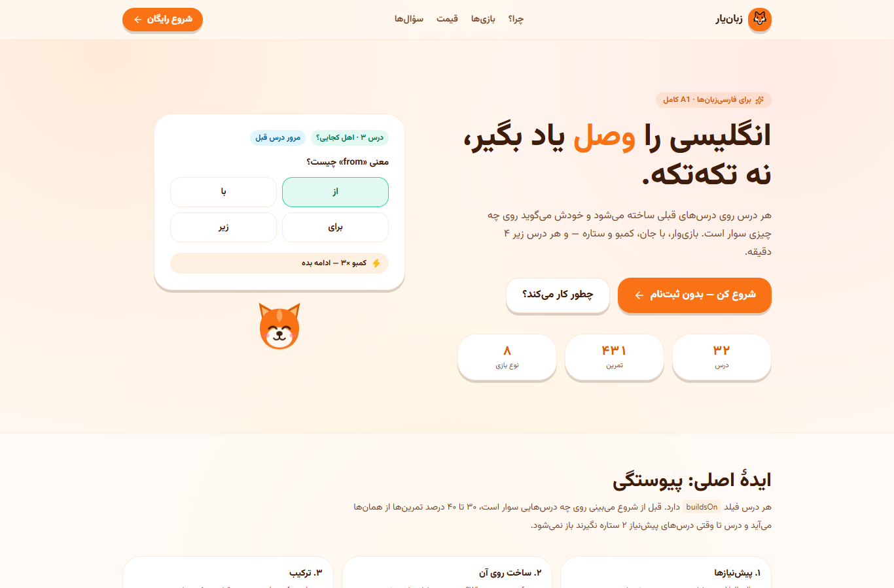
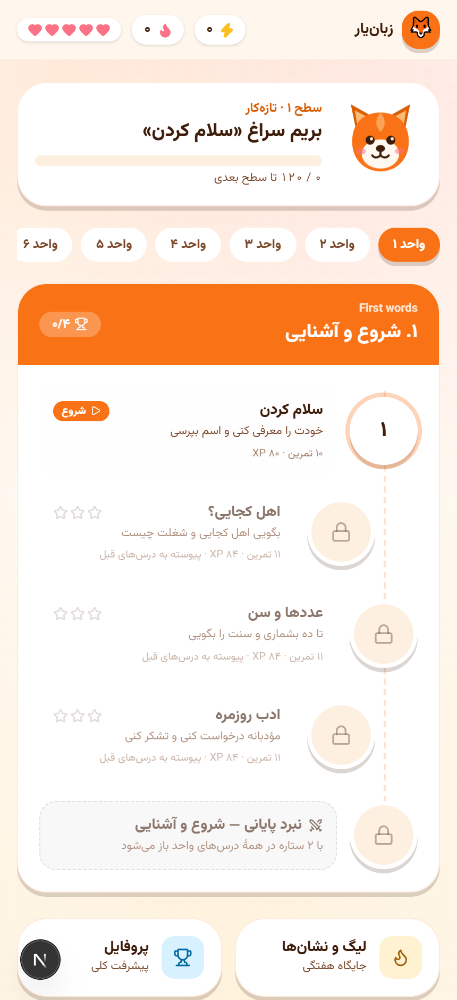
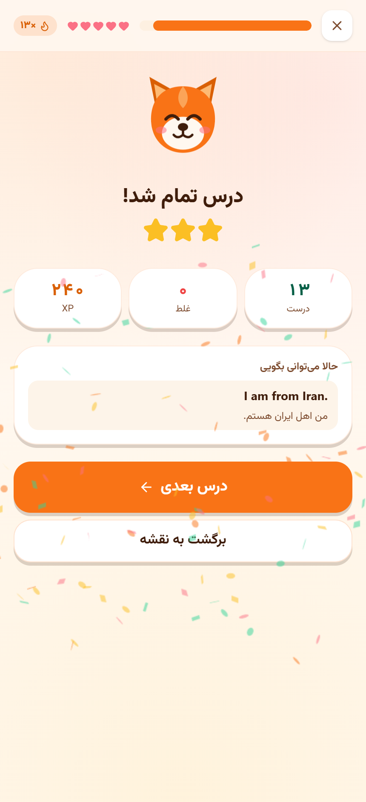
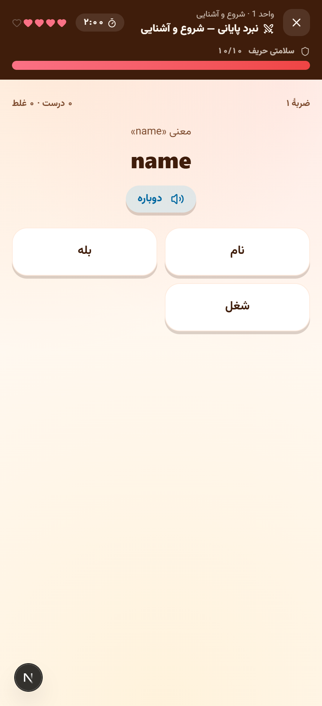
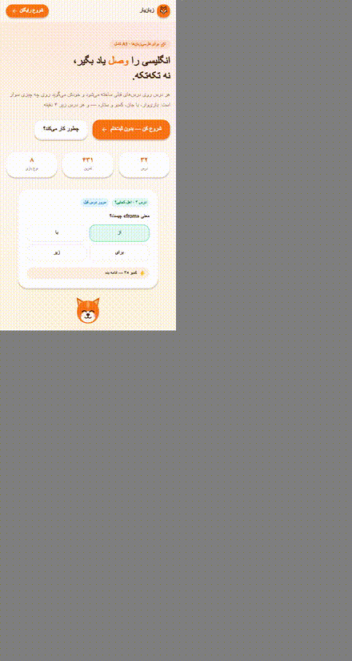

# زبان‌یار — English for Persian speakers

**Live:** https://zabanyar-kappa.vercel.app · **Repo:** https://github.com/MrFox2000/zabanyar

**Status:** v1.0.0 — A1–B2 complete, tested end to end. See [docs/RELEASE.md](docs/RELEASE.md).

A gamified English app **and** its marketing site, in one Next.js repo. Persian, RTL,
mobile-first. Every lesson declares its prerequisites and 30–40% of its exercises come
from them, so the language forms a web instead of a stack of unrelated lessons.

## Look at it



| Map | Lesson finished | Boss battle |
|---|---|---|
|  |  |  |

48-second walkthrough (recorded from the running app, not a mockup):



## What is in here

| Area | Path | What it is |
|---|---|---|
| Marketing site | `src/app/page.tsx` | landing, features, pricing, FAQ |
| App | `src/app/app/*` | map, lesson runner, boss battle, profile, weekly view |
| Content | `src/content/<level>/*.json` | 42 units (A1–B2) · 168 lessons · 2601 exercises |
| Content pipeline | `scripts/gen-content.mjs` | build-time generator for the JSON above |
| AI layer | `src/lib/ai/*`, `src/app/api/ai/*` | flags, client, events, `useAi`, routes |

## Levels

| Level | Units | Lessons | Status |
|---|---|---|---|
| A1 | 8 | 32 | done |
| A2 | 10 | 40 | done |
| B1 | 12 | 48 | done |
| B2 | 12 | 48 | done |

Add a level by dropping `scripts/curriculum/units-<level>-*.mjs` files, listing them in
`scripts/curriculum/index.mjs`, and running `npm run content` — the loader, the map tabs,
the notebook grouping and the word-image downloader all pick it up automatically.

## Numbers that are real

- 42 units (A1–B2), 168 lessons, **2601 exercises**, 42 boss battles
- 8 game types: meaning, picture, listening, fill-the-blank, sentence building,
  match pairs, spot the mistake, speed round
- 0 image or audio assets to license: the fox is inline SVG, audio is the browser's
  speech engine

## Content model

```ts
Lesson {
  id, title, titleFa, goal,
  buildsOn: string[]        // prerequisite lessons → unlocking + interleaved review
  exercises: Exercise[]     // 8 kinds
  youCanSay: {en, fa}[]     // the "what you can now say" card
  tip?: { title, body }     // one rule, then practice
  xp
}
```

Every exercise may also carry `aiHints` (example / simplify / distractors / explanation).
Those fields are ignored today and filled at runtime later — adding AI never changes the
schema.

## Gamification (earned, never sold)

| Loop | How it works |
|---|---|
| XP + levels | XP only from real answers; 10 Persian level titles |
| Streak + freeze | daily streak, and a freeze you can buy with gems to survive one missed day |
| Hearts | 5 lives, one regenerates every 15 minutes |
| Daily missions | 3 missions from real counters, plus a chest that drops XP and gems |
| Gems | earned by learning: 2 per lesson (5 for perfect), 10 per boss, 15 per chest |
| Skins | six background skins bought with gems — cosmetics only, learning is never gated |
| Ranks | bronze → diamond from lifetime XP |
| Share card | `/app/share` posts your real streak and stars |
| Placement | `/app/start`: 8 questions, unlock the level you already handle |

Design notes and monetisation plan: [docs/GROWTH.md](docs/GROWTH.md).

## AI-ready by construction, off by default

Full detail: [`docs/AI.md`](docs/AI.md).

1. `lib/ai/client.ts` is the only model caller, server-side, OpenAI-compatible endpoint.
2. `lib/ai/flags.ts` gates each surface; all `false`.
3. `lib/ai/events.ts` is a typed bus every screen can emit to (answer, mistake, finish).
4. `useAi(feature)` returns `{ available, run, busy }`; when unavailable the static
   experience simply wins. A model failure cannot break a lesson.
5. Nothing is called on load: debounced, cached by prompt, rate-limited per IP.

Turning it on:

```bash
AI_API_KEY=...        # server only
AI_BASE_URL=...       # any OpenAI-compatible base, e.g. https://generativelanguage.googleapis.com/v1beta/openai
AI_MODEL=...
NEXT_PUBLIC_AI_ENABLED=1
```

…then flip the one flag for the surface you want in `src/lib/ai/flags.ts`.

## Run it

```bash
npm install
npm run dev        # http://localhost:3000
npm run build      # next build --webpack
npm run content        # regenerate src/content/a1/*.json
npm run content:check  # 0 problems expected
npm run build:static   # static export to out/ (no server routes)
npm run serve:static   # serve out/ on :3200
```

Progress is stored in `localStorage` (`zabanyar.progress.v1`); hearts regenerate one per
15 minutes; stars are 95% / 80% accuracy thresholds; a lesson unlocks at ≥2 stars on its
prerequisites.

## Repo

https://github.com/MrFox2000/zabanyar

## Checks

- `npm run content:check` — 0 problems (168 lessons, 4 levels)
- browser sweep: 168 lesson pages + 42 bosses + every screen return 200 (see docs/RELEASE.md) (schema, prerequisite graph, duplicate choices, token/answer match, 30–40% review share)
- `npm run lint` — clean
- `npm run build` — 47 routes prerendered
- end-to-end (Playwright): a full lesson with all 8 game types answered correctly →
  3 stars persisted; the unit boss played to victory; the weekly view recomputed from
  real timestamps.

## Deliberately honest

No fake leaderboard: the weekly view is computed from this device's real completion
timestamps, and the 30-person league is labelled as phase 2. No invented users, no
invented numbers.
